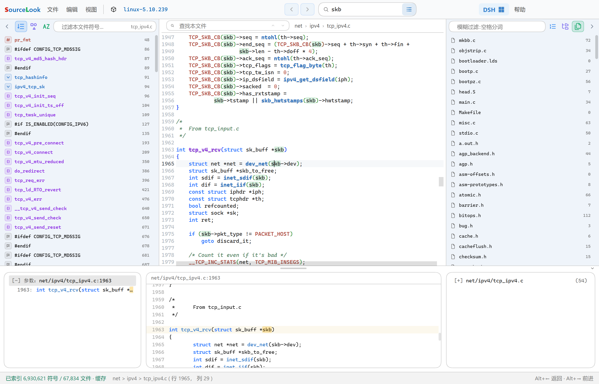
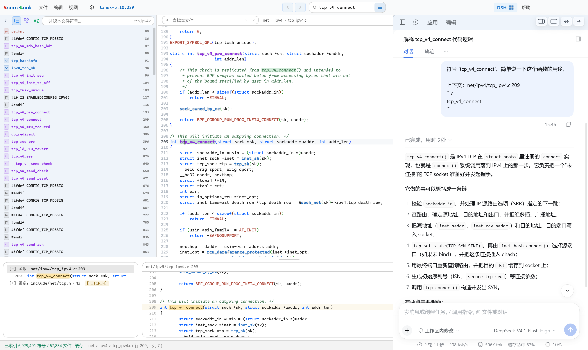
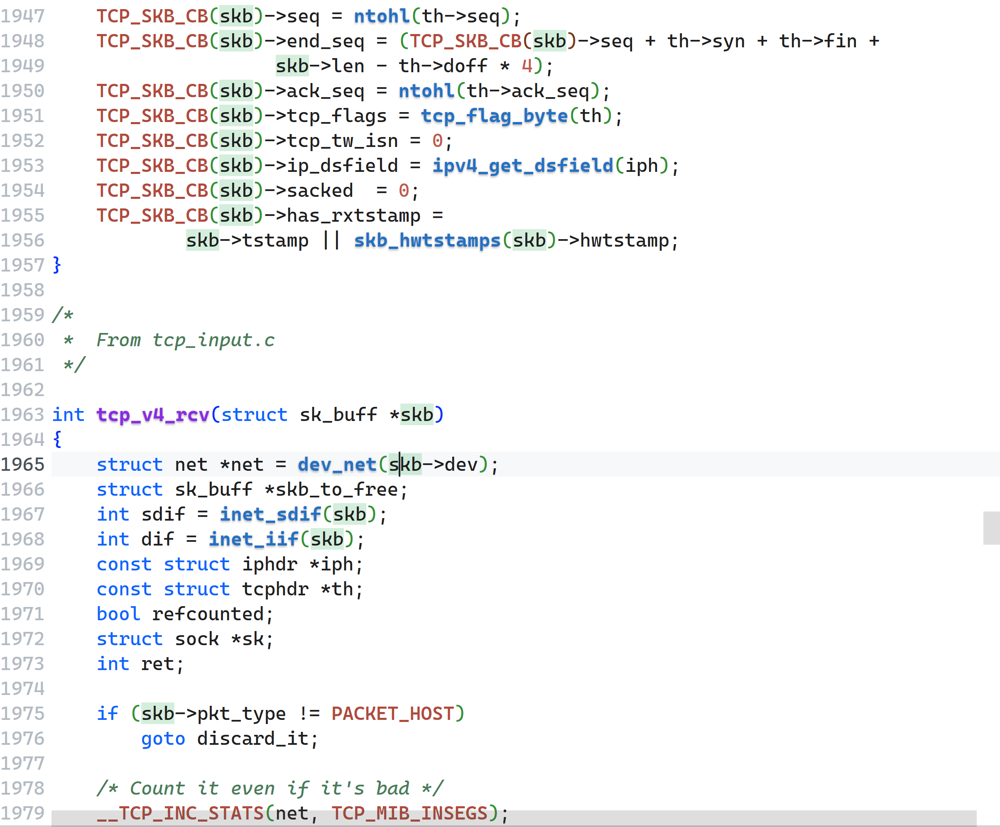

# SourceLook

> A full-window source reader for the Linux kernel and large C codebases,
> built as a [DeepSeek Harness](https://deepseek.com/harness/) plugin.
> Jump to definitions, browse references, and when code gets too dense —
> **just ask DSH, right next to it**.

English ｜ [简体中文](README.md)



No language server, no AST service. The plugin builds its own binary symbol index:
**multi-threaded indexing** completes a large codebase in minutes, and every later
open loads in about a second. Jumps and reference queries respond immediately.

> This page covers the essentials. The [Chinese README](README.md) is the complete reference.

---

## Why it is different from a plain code reader

### 1. Ask when you don't understand — same window

This is the difference from ctags, cscope or a standalone reader: **the reader and the AI
live in one window**.

- Select a piece of code, press `Ctrl+I` (or right-click → AI). The question goes straight
  to the DSH panel on the right.
- The definition card carries type-aware buttons: *what does this function do* / *arguments
  and return value* / *risky spots* / *what does this macro expand to* —
  one click to ask.
- In mode 2 the DSH panel is already docked on the right, so you never leave the code.



### 2. One click, three answers

| Action | Result |
|---|---|
| `F12` / `Ctrl+click` | Jump to definition (multiple hits open the result window) |
| **Click any word** | Bottom panel shows **definition / code / references** at once |
| `Shift+F12` | All references, filtered by symbol kind |
| Right-click → *callees* | Functions called inside the current function body |
| Right-click → *select whole function* | Brace-matched selection, ready to copy or feed to AI |



### 3. It actually understands C

Not a regex that guesses at symbols — a language rule table:

- **Macro-generated names**: `LIST_HEAD(x)`, `DEFINE_PER_CPU(t, n)`, `DECLARE_TRACE(tp)`,
  `DEFINE_EVENT(tpl, name, …)` — the argument *is* the symbol
- **typedef aliases**: `frag->bv_len` follows `skb_frag_t` → `struct bio_vec`
- **Chained members**: `skb->dev->name` resolves through `struct net_device`
- **Bitfields, anonymous unions, `__attribute__((…))`, `__printf(3,0)`** — the syntax tree
  is not torn apart
- **Honest answers for the rest**: a macro parameter says "this is a macro parameter",
  a prototype parameter says "defined in the implementation" with a jump, `__func__` says
  "compiler built-in" — instead of a blanket *unresolved*

### 4. Fast on big trees

- **Multi-threaded indexing**: the whole Linux kernel builds in minutes, runs in the
  background and is cancellable
- **Opens in about a second**: the index is a binary format (`.crdb`), sorted by name and
  binary-searched
- **Instant response on click**: reference queries are filtered by kind and file **inside
  the index layer**, not after loading tens of thousands of rows into memory — common short
  names included

---

## Three window modes

| | Mode 1 (P) | Mode 2 (C, default) | Mode 3 (D) |
|---|---|---|---|
| Looks like | Plugin only, full window | Plugin full width + DSH docked right | DSH only |
| Good for | Focused reading | Read and ask (default) | Chat only |
| Switch | toolbar `DSH` button | toolbar `DSH` button | `Ctrl+Alt+S` |

In mode 3 a small plugin icon stays in the title bar (`应用 编辑 ⬚`) — one click back to the reader:


---

## Install

Installed from a local directory for now (not yet in the official marketplace):

```text
plugin_manager install_bundle <path-to-SourceLook>
```

Then enable it in DSH → Settings → Plugins. The plugin never modifies the DSH
installation; it only registers one `/api/sourcelook` route and one full-window slot.

On first open, click **Build index** in the status bar (multi-threaded, minutes for a large
codebase, runs in the background and is cancellable). Later opens load in about a second.

---

## Shortcuts

| Key | Action |
|---|---|
| `F12` / `Ctrl+click` | Go to definition |
| `Shift+F12` | Find references |
| Click / double-click a word | Bottom panels / floating action bar |
| `Ctrl+I` | Ask AI about the selected word |
| `Ctrl+Alt+P` | Symbol search (DSH owns `Ctrl+P`) |
| `Ctrl+F` / `Ctrl+Shift+F` | Find in file / find in project |
| `F4` / `Shift+F4` | Next / previous result |
| `Alt+←` / `Alt+→` | Back / forward |
| `Ctrl+=` / `Ctrl+-` / `Ctrl+0` | Font size |
| `Ctrl+S` / `Ctrl+W` | Save / close file |
| `Ctrl+Alt+S` | Toggle mode 1 / 3 |

---

## Build from source

Node 22+:

```powershell
node scripts/build.mjs        # concatenates src/client/* into client.js (CSS inlined)
node --check client.js
node scripts/smoke-host.mjs   # file service
node scripts/smoke-index.cjs  # index / outline / definition / references
```

`client.js` is a build artifact — **edit `src/client/`**, never `client.js`.
Restart DSH after a build (the host caches the plugin bundle revision).

---

## Known limitations

- Symbol index covers **C / C++ / Rust / Go** only; JS / TS / Python get syntax
  highlighting but no indexed symbols.
- Semantic colouring paints declaration lines only — no scope resolver, so uses are left
  alone; the decoration is dropped while the buffer has unsaved edits.
- One project root at a time; switching projects means re-selecting the directory.
- No incremental indexing: the index is always rebuilt in full.

---

## License

SourceLook is developed by **Luozy**; the editor and index layers are ported from
KernelSight by the same author.

Released under the [Apache License 2.0](LICENSE), with a [NOTICE](NOTICE) attribution file.
Monaco is MIT; tree-sitter is MIT.
