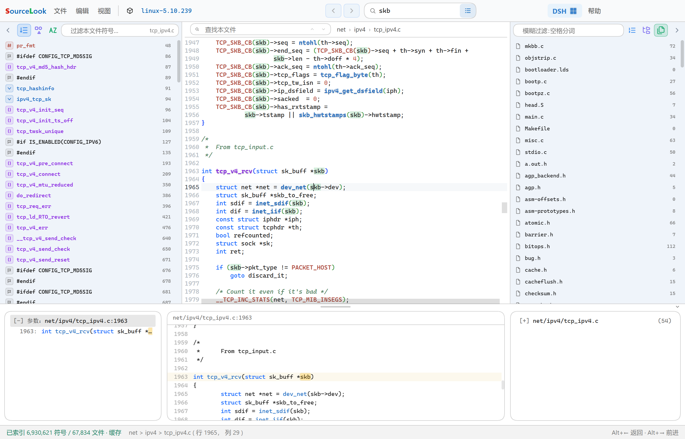
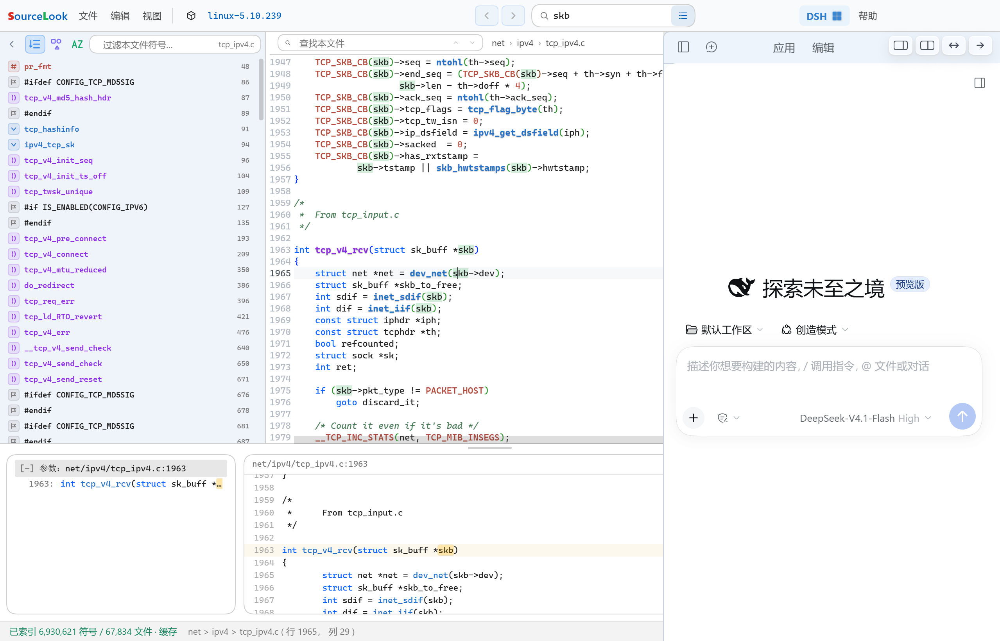
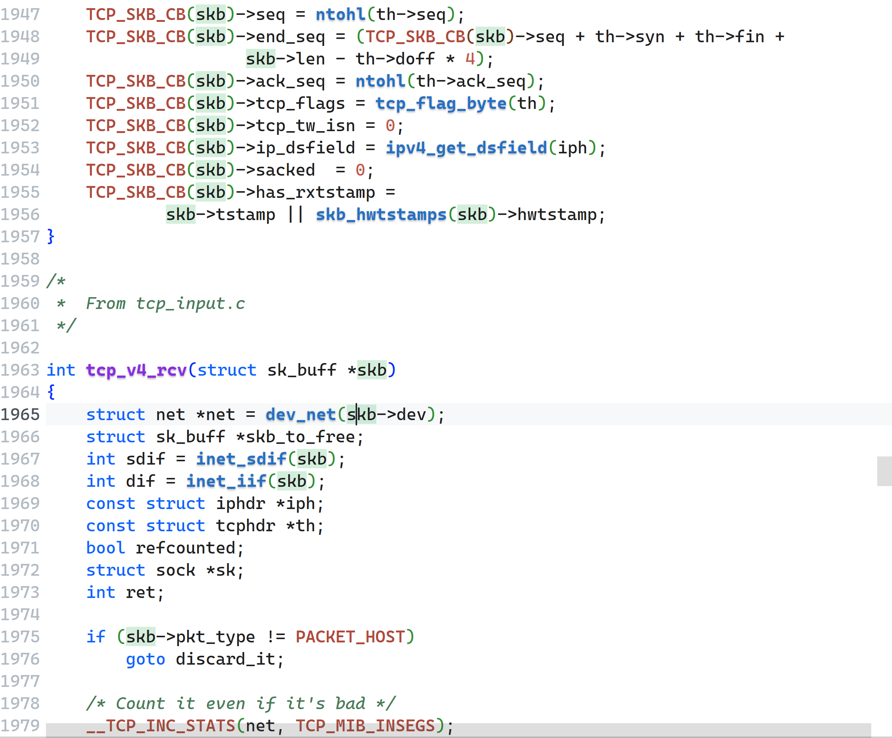

# SourceLook

> 在 DeepSeek Harness 里读 Linux 内核和大型 C 工程。
> 点一下就跳定义、看引用、查调用链；**看不懂的代码，直接让旁边的 DSH 讲给你听**。

**简体中文** ｜ [English](README.en.md)



内存里没有 AST 服务，也没有语言服务器。插件自己建一份二进制符号索引：
**多线程并行建索引**，大型工程几分钟内完成；之后打开工程秒级加载，
所有跳转、引用查询都是即时响应。

---

## 它和普通代码阅读器有什么不一样

### 1. 看不懂就问，不用切窗口

这是它和 ctags / cscope / 普通阅读器最大的区别——**阅读器和 AI 在同一个窗口里**。

- 选中一段代码，`Ctrl+I`（或右键 → AI 解释），问题直接发到右侧 DSH 面板
- 底部「定义卡」上有一排按类型生成的按钮：*这个函数做什么* / *参数与返回值* / *风险点* /
  *这个宏展开成什么*……点一下就问
- 模式 2 里 DSH 就是右边的浮窗，读完代码原地追问，不用 Alt+Tab



### 2. 点一下就有答案

| 操作 | 结果 |
|---|---|
| `F12` / `Ctrl+点击` | 跳到定义；多个结果进结果窗 |
| **单击任意词** | 底部三栏同时给出 **定义 / 代码 / 引用** |
| `Shift+F12` | 引用列表（按函数/变量/类型自动筛） |
| 右键 → 我调用谁 | 扫当前函数体，列出它调用的函数 |
| 右键 → 选中整个函数 | 按花括号配对选中，直接复制或喂给 AI |

单击一个词，底部立刻三栏联动（定义位置、那一行附近代码、所有引用）：



### 3. 它真的看得懂 C

不是正则拼出来的"像符号的东西"，而是按语言规则表解析：

- **宏生成的名字**：`LIST_HEAD(x)`、`DEFINE_PER_CPU(type, name)`、`DECLARE_TRACE(tp)`、
  `DEFINE_EVENT(tpl, name, …)` —— 参数就是符号
- **typedef 别名成员**：`frag->bv_len` 能跟到 `struct bio_vec`
- **链式成员**：`skb->dev->name` 一路推到 `struct net_device::name`
- **位域 / 匿名 union / `__attribute__((…))` / `__printf(3,0)`**：不撕碎语法树
- **说不清的东西会说明白**：宏体形参（`ORDER`）给"这是宏参数"、原型形参（`timeo`）给
  "定义在函数实现里"并给出跳转、`__func__` 给"编译器内建" —— 而不是一律甩一句「未解析」

### 4. 大工程不卡

- **建索引多线程并行**：整个 Linux 内核几分钟就能建完，可后台跑、可取消
- **打开工程秒级加载**：索引是二进制格式（`.crdb`），按名字排序 + 二分查找
- **点一下就是即时响应**：引用查询在索引层就按类型/文件过滤，不会把几万条记录
  搬进内存再挑；高频短名也一样

---

## 三种界面模式

| | 模式 1（P） | 模式 2（C，默认） | 模式 3（D） |
|---|---|---|---|
| 样子 | 只有插件，占满整窗 | 插件全宽 + DSH 浮在右侧 | 只有 DSH |
| 适合 | 专心读代码 | 边读边问（主力） | 只跟 DSH 对话 |
| 切换 | 顶栏 `DSH` 按钮 | 顶栏 `DSH` 按钮 | `Ctrl+Alt+S` |

模式 3 里，左上角标题栏会留一个**插件图标**（`应用 编辑 ⬚`），点一下回到阅读器：


---

## 安装

目前以本地目录方式安装（尚未上架官方插件市场）：

```text
plugin_manager install_bundle <SourceLook 目录>
```

装好后在 DSH 的 Settings → Plugins 里启用。插件不改 DSH 安装目录，只注册一个
`/api/sourcelook` 路由和一个全窗口插槽。

第一次打开工程，点状态栏的 **建立索引**（多线程并行，大型工程几分钟完成，
可后台跑、可取消），之后每次打开都是秒级加载。

---

## 常用快捷键

| 快捷键 | 作用 |
|---|---|
| `F12` / `Ctrl+点击` | 跳定义 |
| `Shift+F12` | 查引用 |
| 单击 / 双击代码里的词 | 底部三栏 / 浮动动作条 |
| `Ctrl+I` | 对选中的词问 AI（发到 DSH） |
| `Ctrl+Alt+P` | 符号搜索（DSH 占用了 `Ctrl+P`） |
| `Ctrl+F` / `Ctrl+Shift+F` | 本文件查找 / 全项目查找 |
| `F4` / `Shift+F4` | 结果窗逐条下一条 / 上一条 |
| `Alt+←` / `Alt+→` | 后退 / 前进 |
| `Ctrl+=` / `Ctrl+-` / `Ctrl+0` | 字号放大 / 缩小 / 重置 |
| `Ctrl+S` / `Ctrl+W` | 保存 / 关闭文件 |
| `Ctrl+Alt+S` | 切换模式 1 / 3 |

---

## 自己构建

需要 Node 22+：

```powershell
node scripts/build.mjs        # 把 src/client/* 拼成 client.js（CSS 内联）
node --check client.js
node scripts/smoke-host.mjs   # 文件服务
node scripts/smoke-index.cjs  # 索引 / 大纲 / 定义 / 引用
```

`client.js` 是构建产物，**改界面改 `src/client/`**，不要直接改它。
改完必须重启 DSH（宿主会缓存插件 bundle 的 revision，网页刷新拿到的是旧版）。

---

## 已知限制

- **符号索引覆盖 C / C++ / Rust / Go / Java / JavaScript / Python**；
  TypeScript 暂走"近似符号"（TS grammar 的节点形状还没适配，宁可不标也不标错），
  其它语言只有语法高亮。
- **语义着色只管声明行**：没做作用域解析，所以使用处不上色；缓冲区有未保存修改时
  直接清空样式，避免错位。
- **一次只服务一个工程根**：换工程需要重新选择目录并建索引（缓存留在磁盘）。
- **不做增量索引**：索引格式一变就整体重建，宁可慢也不留半新半旧的索引。

---

## 许可

SourceLook 由 **Luozy** 开发；其中编辑器与索引部分移植自同作者的 KernelSight。

项目以 [Apache License 2.0](LICENSE) 发布，附带 [NOTICE](NOTICE) 归属声明。
Monaco 为 MIT；tree-sitter 为 MIT。
